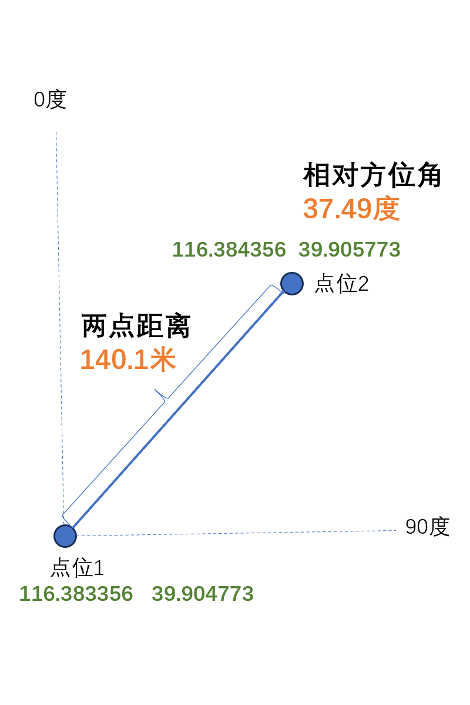
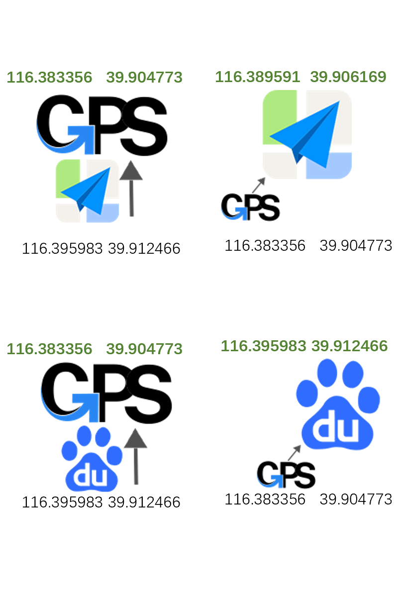
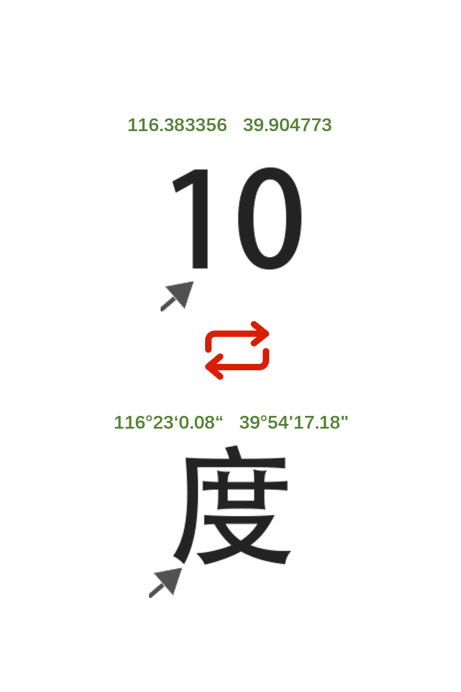
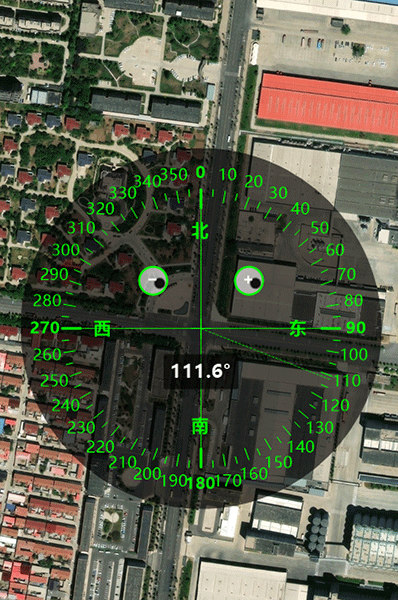
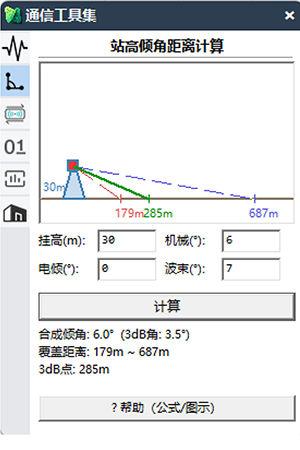
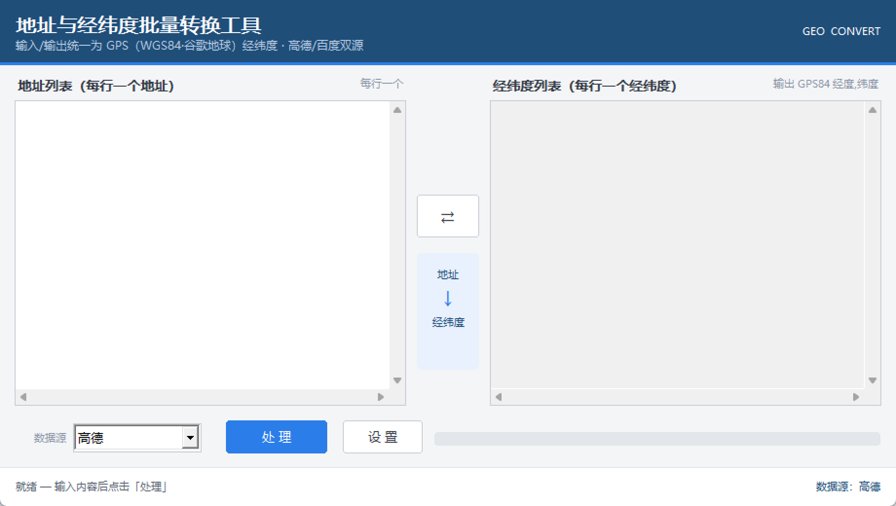
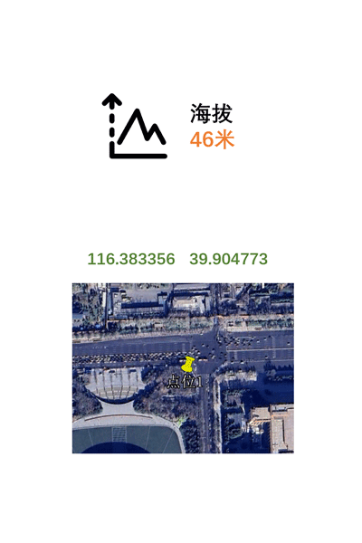

# TableGIS — WPS / Excel 表格地理数据处理工具箱

> 在表格里直接干活：经纬度算距离方位角、坐标互转、批量生成 KML、跳奥维/QGIS、查海拔、匹配最近点、清洗数据、批量文件处理。
> **不用装 GIS 软件，不用写脚本，选中区域点一下就行。**

<p>
  <a href="https://www.tablegis.com"></a>
  <a href="https://www.tablegis.com/faq-more.html"></a>
  
  
</p>

**官网（下载 / 使用说明 / 教程）：<https://www.tablegis.com>**

---

## 这个仓库是什么

这是 **TableGIS 插件**的公开文档与开源算法核心：功能说明、使用教程，以及插件里通用的地理计算算法。

| 目录 | 内容 | 授权 |
|---|---|---|
| [`docs/`](docs/) | 完整功能清单、安装激活、表格公式用法、FAQ、更新日志 | 文档 CC BY-NC-ND 4.0 |
| [`core/`](core/) | 地理计算算法核心（Haversine 距离/方位角、WGS84↔GCJ02↔BD09 坐标转换、度分秒互转），提供 JS / C# / Python 三种实现 | 代码 MIT |
| [`screenshots/`](screenshots/) | 插件界面截图 | 截图 CC BY-NC-ND 4.0 |

完整功能在官网下载安装包：<https://www.tablegis.com>

---

## 功能一览

当前收录 **87 项功能与公式**，每月按实际使用排名做末尾淘汰——用不上的直接下架，不堆功能凑数。

<details open>
<summary><b>GIS / 地图（23 项）</b></summary>

| 功能 | 说明 |
|---|---|
| KML 临时打开 | 选中经纬度区域，一键生成 KML 并在 Google Earth 里打开预览 |
| 扇区覆盖 KML | 按工参表生成扇区覆盖图层，按频段分组着色（方位角+波瓣宽度+长度） |
| 覆盖圆 KML | 按站点经纬度生成圆形覆盖图层，半径可自定义（默认 500 米） |
| 批量 KML | 导入 CSV/Excel 批量生成路测轨迹 KML |
| AOI 边界 | 按地区名搜索 AOI 边界并生成 KML，支持单次/批量 |
| 点-可收藏（奥维） | 选中经纬度一键导入奥维收藏夹，免 VIP、免 Web 接口，支持多选区合并 |
| 奥维标注圆形 | 按经纬度在奥维上画圆，列名含「半径/覆盖距离」自动识别 |
| QGIS 标注点 | 选中经纬度跳转 QGIS 并标注点，清除标记 / 服务器配置齐全 |
| 单表最近点 | 计算每个点到最近 N 个站点的距离与站号（KD-Tree + Haversine） |
| 双表最近点 | 两张表按经纬度就近匹配，A 表每个点找 B 表最近站并回填属性 |
| 经纬度匹配图层 | 判断点在多边形图层内 / 到图层最近距离，属性按单条/合并/展开回填 |
| 经纬度距离聚类 | 按缓冲距离（默认 100 米）对点做分组聚类 |
| 站间距计算 | 计算每个点到最近 N 个点的距离平均值作为站间距 |
| WKT 转图层 | WKT 文本（Point/LineString/Polygon）转 GeoJSON / KML / SHP |
| 点坐标转点图层 | 选中经纬度生成点图层，导出 GeoJSON / KML / SHP |
| 点坐标转扇形 | 按经纬度+方位角+距离+波宽生成扇形图层，支持内半径环形扇区 |
| 点坐标转多边形 | 按经纬度+边数+边长生成正多边形，支持旋转角度 |
| 点坐标转星形 | 按经纬度+角数+半径生成星形，内角可调 |
| 距离 / 方位角 | 选中 4 列计算两点球面距离与方位角，结果复制到剪贴板 |
| 距离 / 方位角公式 | 单元格公式 `=tablegis.DIS(...)` / `=tablegis.AZ(...)`，支持下拉填充 |
| 方位角罗盘 | 悬浮罗盘实时显示鼠标相对中心的方位角，可拖拽缩放 |
| 海拔查询 | 选中经纬度两列批量查高程（米），数据源 Open-Meteo SRTM 90m |
| 匹配工具箱 | 上述匹配类功能的独立 exe 版，左栏切换全部功能 |

</details>

<details open>
<summary><b>坐标与地址（7 项）</b></summary>

| 功能 | 说明 |
|---|---|
| 地址经纬度互转 | 批量地址 ↔ 经纬度互转（支持逆地理），双列互填、切换保留原内容 |
| GPS 转百度 | WGS84 → 百度 BD09 |
| GPS 转高德 | WGS84 → 高德 GCJ02 |
| 高德转 GPS | GCJ02 → WGS84 |
| 百度转 GPS | BD09 → WGS84 |
| 十进制转度分秒 | `116.3975` → `116°23′51″` |
| 度分秒转十进制 | `116°23′51″` → `116.3975` |

</details>

<details>
<summary><b>数据工具（全行业通用，9 项）</b></summary>

| 功能 | 说明 |
|---|---|
| 多 sheet 合并 | 全部工作表合并成一张总表，字段一致对齐，不一致自动新增列 |
| 两列对比 | 选中两列找出各自独有的值并自动标色 |
| 按列拆分 | 按某列的值把整表拆成多个工作表，空值单独成表 |
| 身份证解析 | 批量提取生日/性别/年龄/省份，并校验真伪 |
| 手机号校验 | 批量校验号码、识别运营商、一键脱敏打码 |
| 正则提取 | 批量提取数字/中文/英文/邮箱/手机号/网址/身份证号 |
| 日期转换 | 乱格式日期统一转标准日期（`2026.1.5` → `2026-01-05`），附星期/季度/年月 |
| 金额大写 | 数字金额一键转人民币大写（壹佰贰拾元整），支持负数 |
| 数据生成 | 批量生成随机姓名/手机号/邮箱/身份证/整数/小数/日期 |

</details>

<details>
<summary><b>数据清理（5 项）</b></summary>

提取唯一值 · 删除前后空白 · 只删除中间空白 · 删除所有空白 · 文本转数字

</details>

<details>
<summary><b>码类（4 项）</b></summary>

数据转二维码 / 二维码转数据（离线识别）· 数据转条形码 CODE128 / 条形码转数据

</details>

<details>
<summary><b>图片工具（5 项）</b></summary>

图片插入单元格（按行列自动排布）· 图片适应单元格 · 图片统一尺寸 · 图片对齐单元格 · 批量删除图片

</details>

<details>
<summary><b>文件工具（7 项）</b></summary>

| 功能 | 说明 |
|---|---|
| 批量重命名 | 序号模式，或按 Excel 两列清单（旧文件名 → 新文件名）改名，支持预览与撤销 |
| 文件清单导出 | 文件夹内所有文件导出成表格（文件名/大小/修改日期），支持递归子目录 |
| 图片批处理 | 批量压缩、转格式、限制最大宽度、加文字水印 |
| PDF 合并 | 多个 PDF 按顺序合并，可调整先后次序 |
| PDF 拆分 | 按页拆成单页文件 |
| 图片转 PDF | 多张图片合并成一个 PDF，JPG 直接嵌入不重压缩 |
| 导出 PDF | 当前工作簿一键另存为 PDF |

</details>

<details>
<summary><b>单位转换（14 项）</b></summary>

**功率**：dBm ↔ W　**进制**：2/8/16 ↔ 10 进制互转　**速率**：Gbps / Mbps / Kbps / MB/s 互转

</details>

<details>
<summary><b>通信行业（1 项）</b></summary>

通信工具箱：频段计算、下倾角计算、功率换算、基站参数、速率计算、楼宇穿透

</details>

<details>
<summary><b>插件管理（2 项）</b></summary>

激活插件（授权码激活，首次安装可免费试用）· 检查更新（自动对比服务器最新版本）

</details>

完整说明与教程见 [`docs/features.md`](docs/features.md)，或官网在线教程：<https://www.tablegis.com/docs/>

---

## 界面截图

| 功能市场 | 距离与方位角 |
|---|---|
|  |  |

| 坐标转换 | 度分秒转换 |
|---|---|
|  |  |

| 方位角罗盘 | 通信工具箱 |
|---|---|
|  |  |

| 地址经纬度互转 | 海拔查询 |
|---|---|
|  |  |

---

## 表格公式：在单元格里直接算经纬度

装了插件后，这两个公式在 WPS 和 Excel 里都能直接用，支持引用单元格和下拉填充：

```
=tablegis.DIS(经度1, 纬度1, 经度2, 纬度2)     返回两点地表距离（米，Haversine）
=tablegis.AZ(经度1, 纬度1, 经度2, 纬度2)      返回方位角（0-360°，正北为 0°，顺时针）
```

再也不用把经纬度导出来跑 Python 脚本。详细用法见 [`docs/formulas.md`](docs/formulas.md)。

---

## 开源算法核心（MIT）

`core/` 目录下的算法与插件内部实现完全一致，可自由用于任何项目：

```javascript
// core/js/geo.js
import { distance, azimuth, wgs84ToGcj02 } from './core/js/geo.js';

distance(116.3975, 39.9087, 121.4737, 31.2304);   // 北京 → 上海，单位米
azimuth(116.3975, 39.9087, 121.4737, 31.2304);    // 方位角
wgs84ToGcj02(116.3975, 39.9087);                  // WGS84 → 高德坐标
```

```python
# core/python/tablegis_geo.py
from tablegis_geo import distance, azimuth, wgs84_to_gcj02
```

```csharp
// core/csharp/
double m = GeoCalculator.CalculateDistance(116.3975, 39.9087, 121.4737, 31.2304);
var (lng, lat) = CoordinateConverter.Wgs84ToGcj02(116.3975, 39.9087);
```

包含：

- **距离**：Haversine 球面距离，地球半径 6371000 米
- **方位角**：大圆初始方位角，0-360° 正北顺时针
- **坐标转换**：WGS84 ↔ GCJ02 ↔ BD09 全向互转，含 Krasovsky 椭球偏移算法
- **度分秒**：十进制 ↔ 度分秒互转，支持各种输入写法

详见 [`core/README.md`](core/README.md)。

---

## 安装与激活

1. 到官网下载安装包：<https://www.tablegis.com>
2. 双击安装，打开 WPS 表格或 Excel，TableGIS 选项卡会自动出现
3. 首次安装可直接免费试用，点「激活插件」输入授权码解锁全部功能

支持 **WPS 2019+** 与 **Excel 2013+（.NET Framework 4.7.2）**。详见 [`docs/install.md`](docs/install.md)。

---

## 常见问题

**Q：这个仓库能直接跑出插件吗？**
这里放的是文档和算法核心，安装包在官网下载。

**Q：免费能用吗？**
首次安装可免费试用，群内不定期发放激活码。

**Q：可以在公司电脑上用吗？**
可以，安装包支持离线使用，授权按硬件绑定。

**Q：和 QGIS / ArcGIS 的关系？**
互补。重度的空间分析还是用 GIS 软件，TableGIS 解决的是「数据就在表格里，不想导来导去」这类高频小需求。

更多问题见 [`docs/faq.md`](docs/faq.md)。

---

## 联系与反馈

| 渠道 | 地址 |
|---|---|
| 官网 | <https://www.tablegis.com> |
| 邮箱 | jiaqi0425_000@163.com |
| 微信（功能订制） | `lanhantable` |
| QQ 群（前 100 名免费送激活码） | `908553722` |

有想要的功能，欢迎提 Issue 或在群里说。功能市场每周上新，每月按使用排名淘汰垫底功能。

---

## 授权

- `core/` 下的算法代码：**MIT License**，可商用、可修改、可再分发。
- `docs/` 文档与 `screenshots/` 截图：**CC BY-NC-ND 4.0**，可自由转载（署名 + 链接回本仓库），不可商用、不可修改后分发。

---

<sub>关键词：WPS插件 · Excel插件 · 经纬度批量计算 · 两点距离公式 · 方位角计算 · WGS84 GCJ02 BD09 坐标转换 · 度分秒换算 · KML生成 · 扇区图 · 最近点匹配 · 表格数据处理 · 批量重命名 · 身份证解析 · 二维码批量生成</sub>
